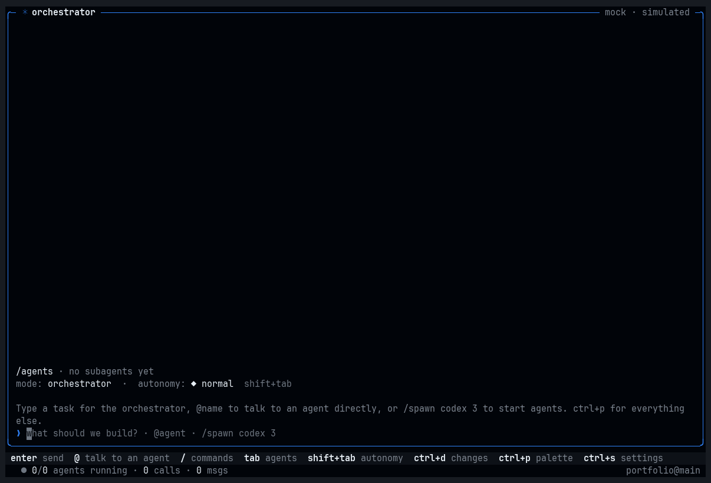

<p align="center">
  
</p>

<h1 align="center">Baton</h1>

<p align="center">
  <b>One terminal for all your coding agents.</b><br>
  Claude Code, Codex, OpenCode, Gemini and more, working together as one team on your code.
</p>

<p align="center">
  <a href="https://github.com/k6w/baton/releases/latest"></a>
  <a href="https://github.com/k6w/baton/actions/workflows/ci.yml"></a>
  <a href="LICENSE"></a>
  
</p>

<p align="center">
  <a href="#install">Install</a> ·
  <a href="docs/quickstart.md">Quickstart</a> ·
  <a href="docs/concepts.md">How it works</a> ·
  <a href="https://k6w.github.io/baton/">Website</a> ·
  <a href="docs/troubleshooting.md">Help</a>
</p>

<p align="center">
  
</p>

---

## What is Baton?

You probably use one coding agent at a time: you open Claude Code *or* Codex, give it a task, and
watch. Baton lets you use **several at once, as a team**, in one window.

- You describe what you want, in plain words.
- An **orchestrator** (one of your agents) plans the work and hands pieces to **workers**: other
  agents, from any vendor, each in its own copy of your project.
- The workers can **talk to each other**, and their work gets **reviewed by a different vendor**.
  It lands in your project only after your tests pass.
- You see everything live: every command, every edit and every message. Anything that needs you
  waits in one inbox.

Baton doesn't replace your agents or their logins. It runs the ones you already have, with your
own accounts. It's free and open source (MIT), and nothing leaves your machine except the calls
your agents already make.

## Install

```sh
curl -fsSL https://raw.githubusercontent.com/k6w/baton/main/install.sh | sh    # macOS, Linux
```

```powershell
irm https://k6w.github.io/baton/install.ps1 | iex                             # Windows (PowerShell)
```

<details>
<summary>Other ways: Homebrew, npm, from source</summary>

```sh
brew install k6w/tap/baton        # Homebrew (macOS, Linux)
npm install -g batonsh            # npm (any Node ≥ 18; macOS, Linux, Windows)
```

From source, with [Bun](https://bun.sh) ≥ 1.3:

```sh
git clone https://github.com/k6w/baton && cd baton
bun install && bun run build      # → dist/baton
```

The installers download one file (`baton`, or `baton.exe`) for your system, check its SHA-256
against the release, and put it on your PATH (`~/.local/bin`, or `%LOCALAPPDATA%\baton\bin`).
`baton update` keeps it current.
</details>

## Your first five minutes

**1. See what Baton found on your machine**

```sh
baton doctor
```

It lists your agents (installed? signed in?), your terminal's features, and anything to fix. An
agent that isn't signed in? `baton login claude` (or `codex`, `opencode`, …) runs that agent's
own sign-in.

**2. Try it with simulated agents (free, no tokens)**

```sh
baton demo
```

Type any task and press <kbd>Enter</kbd>. A pretend team plans, edits, chats and asks for
approval, so you can learn the screen without spending anything. <kbd>?</kbd> shows every key,
and `/guide` has short lessons.

**3. Use it on your project**

```sh
cd my-project
baton
```

The first run sets the folder up: it finds your agents and your test command, and writes a small
`.baton/config.toml`. Then just ask:

> add rate limiting to the login endpoint, with tests

Pick any agents you like. With two vendors (say Claude Code and Codex), each one reviews the
other's work.

## How it works

```
   you ──► orchestrator ──► claude-1 ─┐
              (plans)       codex-1  ─┼─ each in its own git worktree
                            gemini-1 ─┘   they message each other on the bus
                               │
                 review by a different vendor ─► your checks pass ─► merged into your project
```

| | |
|---|---|
| **Orchestrator** | The lead agent. It reads your request, plans it, picks agents and models, and lands their work. You can talk to it, or to any agent directly with `@name`. |
| **Workers** | Every worker gets a **git worktree**: a private copy of your project, including your uncommitted changes. Workers can't step on each other or on you. |
| **Bus** | Agents message each other ("I'm taking the API, can you do the CSS?"). Results flow back to whoever asked automatically. |
| **Reviews** | Before a merge, an agent from *another* vendor reviews the diff. Two models catch more than one. |
| **Merge** | A 3-way merge into your working tree, after your checks (`workspace.verify`) pass. Your branch and staged changes are never touched, and `/undo` reverts a merge. |
| **Inbox** | Approvals, plans to confirm, stuck agents, conflicts: everything that needs you is in one place (<kbd>ctrl</kbd>+<kbd>a</kbd>). |

The full tour, in plain words: **[How Baton works](docs/concepts.md)**.

## Roles, skills and team memory

Workers are only as good as their brief, so Baton helps the lead write a good one:
- **Roles:** tester, reviewer, debugger, refactorer, docs, security, researcher, frontend, or your
  own in `.baton/roles/*.md`. Each brings instructions, an access level (read-only roles can't
  edit, even in YOLO), a model size and a "done when" check. `/spawn tester` starts one.
- **Acceptance checks:** the lead sets a command (`bun test src/auth`), and Baton runs it when the
  worker finishes. The work counts only when it passes; the worker gets two more tries.
- **Skills:** `.baton/skills/<name>/SKILL.md` (or your `.claude/skills`). Every agent sees what's
  available and loads what it needs. Works with Codex, OpenCode and Gemini too, not just Claude.
- **Team notes:** facts agents learn ("tests need DB_URL") go into `.baton/notes.md`, and every
  new worker starts with them.

`/roles`, `/skills`, `/notes`, `/team <name>` in the app. All of it: [roles, skills and notes](docs/roles.md).

## How much freedom agents get

One dial controls **every** agent at once, the lead and the workers, even while they run.
Press <kbd>shift</kbd>+<kbd>tab</kbd> to turn it.

| Mode | What agents may do without asking you |
|---|---|
| ◆ **normal** | each agent's own defaults: reads and edits are fine, risky commands ask |
| ↯ **auto** | anything inside your project; destructive commands still ask |
| ▲ **yolo** | everything, no prompts, no sandbox. Your deny rules still apply |
| ◇ **ask** | nothing: every edit and command waits for you |

Rules you write (for example "never `git push`") hold in every mode. Commands from untrusted repos
need `baton trust` first.

## Everyday keys

| Key | What it does |
|---|---|
| <kbd>Enter</kbd> | send a message to the orchestrator (`@codex-1 …` talks to one agent) |
| <kbd>ctrl</kbd>+<kbd>a</kbd> | inbox: everything that needs you (<kbd>ctrl</kbd>+<kbd>y</kbd> approves the oldest) |
| <kbd>tab</kbd> | move to the agents, then <kbd>z</kbd> zoom · <kbd>space</kbd> peek & reply · <kbd>esc</kbd> back |
| <kbd>ctrl</kbd>+<kbd>d</kbd> | changes: every agent's diff, merge or review it |
| <kbd>ctrl</kbd>+<kbd>g</kbd> | the plan: tasks, owners, progress (editable) |
| <kbd>ctrl</kbd>+<kbd>p</kbd> | command palette: search everything |
| <kbd>ctrl</kbd>+<kbd>s</kbd> · <kbd>ctrl</kbd>+<kbd>t</kbd> | settings · themes |
| <kbd>?</kbd> | all keys (every one can be changed) |

Slash commands: `/merge all` · `/undo` · `/review codex-1` · `/spawn claude 2 tests` · `/style` ·
`/costs` · `/history` · `/guide`. Press <kbd>/</kbd> to see them all.

## Works with the agents you already use

| Agent | How Baton talks to it |
|---|---|
| **Claude Code** | Agent SDK (your Claude Code login or API key) |
| **Codex** | `codex app-server` (your ChatGPT login or API key) |
| **OpenCode** | `opencode serve` |
| **Gemini, Cursor, Copilot, Goose, Kiro, Qwen, Cline, Kimi, Droid, …** | [Agent Client Protocol](https://agentclientprotocol.com) |
| **Aider, Crush and any other CLI** | in a terminal session (PTY) |
| **Remote agents** | [A2A](https://a2a-protocol.org) |
| **Baton's own agent** | built in: any model provider, local models too |

Each agent is driven through its real interface (not by scraping its screen), so you see proper
tool calls, diffs, costs and approvals from all of them. Adding your own takes a few lines of
config: [agents & providers](docs/agents.md).

## Beyond the terminal

- **Phone:** `baton web --lan` shows a QR code. Follow along, approve and send tasks from your
  phone, with one-tap approve/deny from notifications (ntfy, Slack).
- **Scripts and CI:** `baton run "update the changelog" --approve all --json`.
- **From other tools:** `baton mcp` lets Claude Desktop, Cursor or any MCP client hand tasks
  to your team. `baton a2a` serves it to other agents.
- **GitHub:** `baton issue 42` starts from an issue, and `/pr` opens a draft pull request from
  what was merged.
- **History:** every run is saved. `ctrl+r` resumes one, `baton replay` plays it back, and
  `baton export` writes Markdown or HTML.
- **Track record:** Baton learns which agent is good at what in *your* project (`/scores`),
  and the orchestrator uses that to pick who does what.

## Make it yours

- **Looks:** 11 styles (`/style`) and ~50 themes (<kbd>ctrl</kbd>+<kbd>t</kbd>), all meeting
  WCAG contrast, and any combination works. `/background terminal` keeps your terminal's own
  (even transparent) background.
- **Layouts:** grid, list, focus, swarm, wide (<kbd>ctrl</kbd>+<kbd>l</kbd>).
- **Everything else:** budgets, models per task size, approval rules, notifications, sounds, key
  bindings. `ctrl+s` has it all with explanations, or edit `.baton/config.toml`
  ([configuration](docs/configuration.md)).

## Documentation

| Start here | Go deeper | Reference |
|---|---|---|
| [Quickstart](docs/quickstart.md) | [Roles, skills & notes](docs/roles.md) · [Workspaces & reviews](docs/workspaces.md) | [Configuration](docs/configuration.md) · [Command line](docs/cli.md) |
| [How Baton works](docs/concepts.md) | [Agents & providers](docs/agents.md) | [Keybindings](docs/keybindings.md) |
| [Troubleshooting & FAQ](docs/troubleshooting.md) | [Phone & web](docs/remote.md) · [Teams & GitHub](docs/integrations.md) | [Themes & styles](docs/themes.md) |
| | [The Baton agent](docs/native-agent.md) · [A2A](docs/a2a.md) | [SDK & protocol](docs/sdk.md) · [Changelog](CHANGELOG.md) |

All of it is also on the website: **[k6w.github.io/baton](https://k6w.github.io/baton/)**.

## FAQ

<details>
<summary><b>Does it cost anything?</b></summary>

Baton is free. Your agents cost what they always do, on your own plans and keys. <kbd>ctrl</kbd>+<kbd>e</kbd>
shows spend per agent, and budgets (`budget.run_usd`) stop work at a limit.
</details>

<details>
<summary><b>Do I need several agents?</b></summary>

No. One works fine: the orchestrator can run several copies of the same agent in parallel.
Two vendors add cross-reviews.
</details>

<details>
<summary><b>Is my code safe?</b></summary>

- Workers edit private copies, and nothing reaches your files until a merge, which `/undo` reverts.
- Risky commands ask first (unless you turn the dial up), and your deny rules always hold.
- Baton has no server and no telemetry by default. It never reads or stores your agents' credentials.
</details>

<details>
<summary><b>Windows?</b></summary>

Yes: install with PowerShell (`irm https://k6w.github.io/baton/install.ps1 | iex`) and run `baton`
in Windows Terminal. It needs [Git for Windows](https://git-scm.com/download/win). WSL works
too, with the Linux installer.
</details>

More: [troubleshooting & FAQ](docs/troubleshooting.md).

## Contributing

```sh
bun install
bun test                                    # ~480 tests
bunx tsc -p tsconfig.json --noEmit && bunx biome check .
bun packages/cli/src/main.ts demo           # run from source
```

The code is a Bun + TypeScript monorepo:

| Package | What it does |
|---|---|
| `protocol` | events, the adapter contract, the control protocol |
| `kernel` | config, the event store, state |
| `daemon` | the runtime, bus, policy, worktrees |
| `adapters/*` | one package per agent family |
| `tui` | the terminal UI (OpenTUI + Solid) |
| `cli` | the `baton` command |
| `sdk` | the TypeScript client |

There's also a Python SDK in `sdk-python`. Releases: `bun scripts/version.ts 0.2.0`, commit,
then `git tag v0.2.0 && git push --follow-tags`. CI builds, signs and publishes everything.

## License

MIT. Agent logos come from [LobeHub Icons](https://github.com/lobehub/lobe-icons) (MIT); they're
trademarks of their owners and only identify which agent is running.
